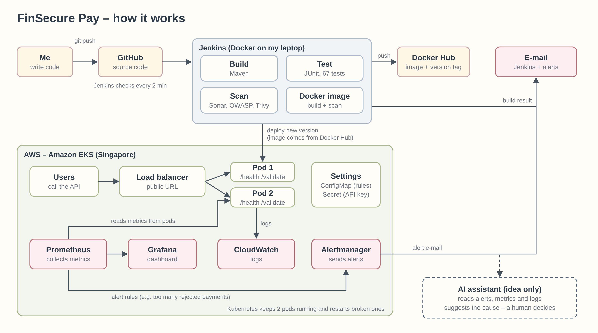

# FinSecure Pay — Transaction Validation API

This is my DevOps capstone project. It is a small Spring Boot API that checks payment transactions, plus everything needed to build, test, scan, deploy and monitor it automatically on **Amazon EKS**.



## What is in the project

| Part | Tools |
| --- | --- |
| Application | Java 21, Spring Boot 4.1, Maven, JUnit 5 |
| Container | Docker (small Alpine image, non-root user), Docker Hub |
| Kubernetes | Amazon EKS, Deployment (2 pods), Service with an AWS load balancer, ConfigMap, Secret, probes, autoscaling |
| CI/CD | Jenkins (runs in Docker on my laptop, set up as code), `Jenkinsfile` |
| Security | SonarQube, OWASP Dependency-Check, Trivy, Gitleaks, 80% test coverage gate |
| Monitoring | Prometheus, Grafana, Alertmanager (e-mail alerts), CloudWatch Logs |

## The API

| Method | Path | What it does |
| --- | --- | --- |
| `GET` | `/health` | Returns `{"status":"UP","version":"..."}`, or 503 when the app is not ready. Docker and all Kubernetes probes use it too |
| `POST` | `/validate` | Checks one transaction. `200` = approved, `422` = rejected (with every failed rule), `400` = bad JSON, `401` = missing `X-API-Key` |
| `GET` | `:8081/actuator/prometheus` | Metrics for Prometheus (only inside the cluster) |

Example:

```bash
curl -s -X POST http://localhost:8080/validate -H 'Content-Type: application/json' -d '{
  "transactionId": "TXN-0001", "sourceAccount": "ACC12345678", "destinationAccount": "ACC87654321",
  "amount": 250.00, "currency": "USD" }'
# {"transactionId":"TXN-0001","status":"APPROVED","valid":true,"riskLevel":"LOW","reviewRequired":false,"errors":[],...}
```

### Validation rules

There was no official specification, so I chose rules that a real payment system would need:

| Rule | Why |
| --- | --- |
| Transaction ID: 6–64 letters, digits or hyphens | To find a payment later and block strange input |
| Account format `ACC` + 8 digits | Catches typos and fake accounts |
| Source and destination must be different | Paying yourself is usually a mistake |
| Account not on the block list | Fraud and sanctions compliance |
| Amount above 0, at most 2 decimals | Money cannot be negative; currencies only have cents |
| Amount at most 10,000 | Limits damage from fraud or errors |
| Currency: USD, EUR, GBP, SGD or THB | We only settle these currencies |
| Timestamp not in the future and not older than 24 h | Blocks wrongly dated or replayed requests |

Approved payments of 5,000 or more get `riskLevel: HIGH` and `reviewRequired: true`. The limit, currencies and block list are in `k8s/02-configmap.yaml`, so they can change without a new build.

## Run it on your computer

```bash
mvn clean verify                      # builds the app and runs the 67 tests (fails below 80% coverage)
mvn spring-boot:run                   # then open http://localhost:8080/health
scripts/local-run.sh 1.0.0-local      # builds the Docker image, runs it and calls /health and /validate
```

## Folder guide

```
src/          application code and JUnit 5 tests
Dockerfile    container image (uses the jar that passed the tests)
Jenkinsfile   the CI/CD pipeline
k8s/          Kubernetes files: namespace, ConfigMap, Deployment, Service, autoscaler, PDB
infra/eks/    EKS cluster definition and the IAM policy for Jenkins
jenkins/      Jenkins + SonarQube setup (docker-compose, plugins, config as code)
monitoring/   Prometheus alert rules, Grafana dashboard, Alertmanager settings
scripts/      deploy, rollback, smoke test, traffic generator, pod recovery demo
images/       architecture diagram
```

## Set up from zero

You need: Git, Java 21, Maven, Docker Desktop, AWS CLI, eksctl, kubectl and Helm (`brew install git openjdk@21 maven awscli eksctl kubectl helm gettext`), plus accounts on GitHub, Docker Hub, AWS and Gmail (for alert e-mails, with an app password).

1. **Build and test:** `mvn clean verify` (67 tests must pass).
2. **Run in Docker:** `scripts/local-run.sh` (builds the image, runs it, calls `/health` and `/validate`).
3. **Push the image:** `docker buildx build --platform linux/amd64 -t docker.io/<user>/finsecure-pay:<version> --push .` (EKS nodes are amd64).
4. **AWS users:** `aws configure` with an admin key. Create the IAM user `jenkins-deployer` with the policy in `infra/eks/jenkins-deployer-iam-policy.json`.
5. **Create the cluster:** `eksctl create cluster -f infra/eks/cluster.yaml` (about 20 min), then `scripts/bootstrap-cluster.sh`.
6. **First deploy:** set `IMAGE`, `APP_VERSION` and `FINSECURE_API_KEY`, then `scripts/deploy.sh` and `scripts/smoke-test.sh <version>`.
7. **Monitoring:** set `ALERT_EMAIL_TO`, `SMTP_USERNAME`, `SMTP_PASSWORD` and `GRAFANA_ADMIN_PASSWORD`, then `scripts/install-monitoring.sh`.
8. **Jenkins + SonarQube:** create `jenkins/.env` with these values, then `cd jenkins && docker compose up -d --build`. Open http://localhost:8080. The `finsecure-pay` job polls GitHub every 2 minutes.

   `JENKINS_ADMIN_ID`, `JENKINS_ADMIN_PASSWORD`, `GITHUB_REPO_URL`, `GITHUB_USER`, `GITHUB_TOKEN`, `DOCKERHUB_USER`, `DOCKERHUB_TOKEN`, `DOCKERHUB_REPO`, `AWS_ACCESS_KEY_ID`, `AWS_SECRET_ACCESS_KEY` (of `jenkins-deployer`), `AWS_REGION`, `EKS_CLUSTER`, `SONAR_HOST_URL`, `SONAR_TOKEN`, `NVD_API_KEY` (optional), `FINSECURE_API_KEY`, `SMTP_HOST`, `SMTP_PORT`, `SMTP_USERNAME`, `SMTP_PASSWORD`, `NOTIFY_EMAIL`
9. **Clean up:** `kubectl delete namespace finsecure monitoring`, then `eksctl delete cluster -f infra/eks/cluster.yaml --disable-nodegroup-eviction`.

## Logs and troubleshooting

| What | How |
| --- | --- |
| Live logs of both pods | `kubectl -n finsecure logs -l app.kubernetes.io/name=finsecure-pay --prefix --tail=100` |
| A pod that crashed | `kubectl -n finsecure logs <pod> --previous` |
| Why a pod is not ready | `kubectl -n finsecure describe pod <pod>` (read Events at the bottom) |
| Old logs from all pods | CloudWatch → Logs Insights → log group `/aws/containerinsights/finsecure-eks/application` |
| Pipeline problems | Jenkins → the build → Console Output (also attached to the failure e-mail) |

Account numbers are masked in the logs (`ACC****5678`). Example Logs Insights query for rejected payments:

```
fields @timestamp, kubernetes.pod_name, log_processed.message
| filter kubernetes.namespace_name = "finsecure" and log_processed.message like /transaction rejected/
| sort @timestamp desc | limit 50
```

When the rejection-rate alert fires: open Grafana → "Validation failures by rule" to see which rule jumps. If it happened right after a deploy, check the last ConfigMap change and roll back with Jenkins `ACTION=rollback`.

> No passwords, keys or tokens are stored in this repository. Jenkins reads them from `jenkins/.env`, which Git ignores, and the app's API key only reaches the cluster as a Kubernetes Secret.
