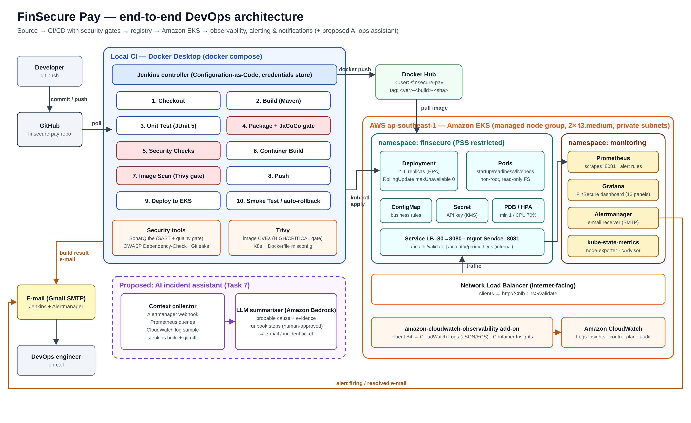

# FinSecure Pay — Design Document

Author: Mayurint · October 2026

This document explains how I built and deployed the FinSecure Pay transaction validation API: the architecture, why I chose each tool, how the system is secured, how it recovers from failures, and one AI idea for operations.

## 1. Goal

FinSecure Pay is a small fintech start-up. It wants to release its transaction validation API quickly and safely, with as few manual steps as possible. My job as the DevOps engineer was to take the app from source code to a production-style setup in the cloud, with security checks, monitoring, alerts and automatic recovery.

Repository: `https://github.com/mauyrint/finsecure-pay` · Image: `docker.io/<your-user>/finsecure-pay`

## 2. Architecture

A code change goes from GitHub to Jenkins, then to Docker Hub, and finally to Amazon EKS. Prometheus, Grafana, Alertmanager and CloudWatch watch the running app.

Jenkins checks GitHub every 2 minutes. For each new commit it builds and tests the app, runs the security scans, pushes a uniquely tagged image to Docker Hub and deploys it to EKS. It then runs a smoke test and rolls back if the deployment or the test fails. Users reach the API through an AWS load balancer that sends traffic to two or more pods.

## 3. The application and its validation rules

The API has two endpoints. `POST /validate` checks one transaction and returns `200 APPROVED` or `422 REJECTED` with a list of every rule that failed. `GET /health` returns `UP` and the running version. There was no official rule specification, so I defined the rules myself, based on common checks in payment systems:

| Rule | Why it matters |
| --- | --- |
| Transaction ID: 6–64 letters, digits or hyphens | Needed to find a payment later; blocks strange or harmful input |
| Account format `ACC` + 8 digits | Catches typos and fake accounts early |
| Source and destination must be different | Sending money to the same account is usually a mistake |
| Account not on the block list | Compliance: accounts linked to fraud or sanctions must be stopped |
| Amount above 0, at most 2 decimals | Money cannot be negative, and currencies only have cents |
| Amount at most 10,000 | Limits the damage from fraud or errors |
| Currency is USD, EUR, GBP, SGD or THB | We can only settle currencies we support |
| Timestamp not in the future, not older than 24 hours | Blocks wrongly dated or replayed requests |

Approved payments of 5,000 or more get a HIGH risk level and `reviewRequired: true`, so a person can check them. The limit, currencies and block list live in a Kubernetes ConfigMap, so they can change without a new build. I wrote 67 JUnit 5 tests that check passing and failing input for every rule, and the build fails if test coverage drops below 80%.

## 4. Tool choices and design decisions

| Tool | Why I chose it |
| --- | --- |
| Jenkins in Docker (on my laptop) | Free, and easy to rebuild with one command |
| Small Alpine Java image, non-root user | Fewer vulnerabilities; ships the jar that passed the tests |
| Docker Hub, one tag per build | Free, and I can trace every pod back to a commit |
| Amazon EKS in Singapore | Managed Kubernetes in the region closest to Thailand |
| 2 replicas, rolling update, autoscaling 2–6 | No downtime during updates; survives one pod failing |
| Probes on `/health` | Traffic stops going to a pod that is not ready |
| Prometheus, Grafana, Alertmanager | Free, standard tools; rules are stored in Git |
| CloudWatch Logs | No extra servers to run (but it ties us to AWS) |

The pipeline stages are: Checkout → Build → Unit Test → Package → Security Checks → Container Build → Image Scan → Push → Deploy → Smoke Test. If one stage fails, the rest are skipped, so a failing test or a security finding never reaches the cluster.

## 5. Security

- **Security gates:** five checks can stop a release: SonarQube (code quality), OWASP Dependency-Check (blocks libraries with a CVSS score of 7 or more), Trivy (image and Kubernetes files), Gitleaks (secrets in Git) and the 80% coverage gate. To test this, I added `commons-text 1.9` (CVE-2022-42889, score 9.8). The pipeline stopped. After I removed it, the build passed again.
- **Secrets:** no password or token is in the code. Jenkins keeps them in its credential store and hides them in the logs. The app's API key reaches Kubernetes only as a Secret, created during deployment and encrypted at rest by EKS.
- **Least privilege:** the Jenkins AWS user can only deploy into the `finsecure` namespace. It cannot change or delete the cluster.
- **Hardened pods:** they run as a non-root user with a read-only file system and no extra Linux permissions. Metrics are only available inside the cluster.
- **Known risk:** for this lab, Jenkins runs as root so it can use Docker on my laptop. In production I would use separate build agents instead.

## 6. Recovery

The app is stateless, so recovery means replacing pods or going back to an earlier version.

- **A pod crashes or is deleted:** Kubernetes creates a new one. In my test the new pod was ready in about 30–40 seconds, and the other pod kept serving traffic.
- **The app freezes:** the liveness probe fails and Kubernetes restarts the container.
- **A bad release:** old pods keep running until new ones are ready. If the rollout or the smoke test fails, Jenkins runs `kubectl rollout undo`. I can also roll back by hand with the Jenkins option `ACTION=rollback`.
- **High traffic:** the autoscaler adds pods (up to 6) when CPU usage is high.
- **The whole cluster is lost:** everything is stored as code, so I can rebuild it in about 30 minutes with `eksctl`, the setup scripts and one pipeline run.

## 7. AI use case: AI-assisted incident triage

**The problem, and why AI fits.** When an alert fires, the on-call engineer has to check Grafana, logs, Jenkins and Git to find out what changed. For a small team this takes a long time, especially at night. The task is to read mixed information (numbers, log text, code changes) and explain it. Fixed rules cannot do this well, but a large language model (LLM) can.

**Inputs.** The alert; 30 minutes of related metrics from Prometheus; about 200 recent warning and error log lines from CloudWatch (account numbers are already masked); Kubernetes events; the latest Jenkins builds and their code changes; and the matching runbook section.

**How it works.** Alertmanager sends the alert to a small service. The service collects the inputs and asks an LLM on Amazon Bedrock (the data stays in our AWS account) for a short summary, the most likely cause with evidence, and suggested runbook steps. The answer is added to the alert e-mail. *Example:* "The rejection rate rose to 65% at 14:02. 95% of the failures are `AMOUNT_LIMIT_EXCEEDED`. Build #42 at 13:58 changed the limit from 10,000 to 1,000. Suggestion: roll back to the previous version."

**Expected benefits.** Faster diagnosis (my target is 30–50% less time to fix change-related incidents), a consistent first response at night, and an incident timeline for the post-mortem.

**Limitations and risks.** The model can be wrong or invent causes, so every claim must show its evidence. Logs could contain sensitive data, so only masked data is sent, and every request is logged. Log text could try to trick the model (prompt injection), so the assistant has read-only access. There is also a cost per request, so it only runs for real alerts.

**Governance: the AI recommends, the engineer decides.** A named person, the DevOps engineer on call, makes every decision and stays responsible for it.

- **It may do alone:** read data and add a summary to the alert, marked "AI-generated, not checked".
- **It needs human review for:** any action, such as a rollback or a config change. The engineer checks the evidence and runs the action through the normal Jenkins pipeline.
- **It may never:** run `kubectl`, Jenkins jobs or AWS changes itself, see secrets, or close or silence an alert.

**What happens when the AI is wrong?** Nothing changes in production, because it cannot change anything. The engineer sees that the evidence does not match, follows the normal runbook, and marks the answer as wrong. These cases are reviewed every month to improve the prompt.

**Integration.** No change to the app is needed. I would add a webhook receiver to Alertmanager next to the e-mail receiver, and give the service read-only access to Prometheus, CloudWatch and Jenkins.

## 8. Lessons learned and future improvements

**Lessons learned.**

- A pipeline is only trustworthy if you have seen it fail. Breaking it on purpose showed the gates really work.
- Alerts on business numbers, like the rejection rate, find problems that CPU alerts miss.
- Security tools are part of the supply chain too: I pinned Trivy to 0.69.3 because 0.69.4–0.69.6 were compromised in March 2026.

**Future improvements.** GitOps with Argo CD and canary releases, short-lived OIDC credentials instead of AWS keys, Amazon ECR with signed images, Terraform, AWS Secrets Manager, separate staging and production, and the AI assistant above.
